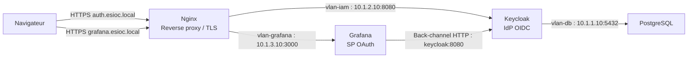

# Infrastructure IAM / SSO avec Keycloak et Grafana

## Présentation du projet

Ce projet déploie une infrastructure de gestion des identités et des accès (IAM) et d'authentification unique (SSO) fondée sur OpenID Connect (OIDC) et OAuth 2.0. Keycloak fournit l'identité, Grafana consomme l'authentification fédérée, PostgreSQL assure la persistance et Nginx publie les interfaces en HTTPS.

Les services sont répartis sur des réseaux Docker dédiés. Seul Nginx publie des ports, liés à l'interface locale de l'hôte.

> **Avertissement — laboratoire pédagogique / PoC :** cette configuration sert à l'expérimentation et à la démonstration. Elle n'est pas une configuration de production. En particulier, Keycloak est lancé avec `start-dev`, les certificats sont auto-signés et les paramètres de durcissement, de sauvegarde et de haute disponibilité restent à définir.

## Architecture technique et réseau

### Composants

| Composant | Rôle |
|---|---|
| Nginx | Reverse proxy, terminaison TLS et redirection HTTP vers HTTPS |
| Keycloak | Fournisseur d'identité (IdP), authentification OIDC et émission des jetons |
| Grafana | Service Provider (SP), authentification OAuth générique via Keycloak |
| PostgreSQL | Persistance des données Keycloak |

### Schéma des flux



### Cloisonnement réseau Docker

| Réseau | Sous-réseau | Membres / usage | Particularités |
|---|---|---|---|
| `vlan-db` | `10.1.1.0/24` | PostgreSQL (`10.1.1.10`) et Keycloak (`10.1.1.20`) | `internal: true` : réseau isolé sans accès externe. Aucun port PostgreSQL publié sur l'hôte. |
| `vlan-iam` | `10.1.2.0/24` | Keycloak (`10.1.2.10`), Grafana (`10.1.2.20`) et Nginx (`10.1.2.30`) | Communication interne pour l'IdP et les échanges back-channel. |
| `vlan-grafana` | `10.1.3.0/24` | Grafana (`10.1.3.10`) et Nginx (`10.1.3.20`) | Liaison interne utilisée par Nginx pour joindre Grafana. |

Les réseaux `vlan-iam` et `vlan-grafana` sont des réseaux bridge Docker dédiés, mais ne sont pas déclarés `internal: true` dans la configuration actuelle. Les seuls ports publiés sur l'hôte sont ceux de Nginx, liés à `127.0.0.1`.

### Séparation des flux SSO

- **Front-channel :** le navigateur accède aux URL `https://auth.esioc.local` et `https://grafana.esioc.local`. L'authentification et les redirections OIDC transitent par HTTPS via Nginx.
- **Back-channel :** Grafana communique directement avec Keycloak sur le réseau Docker, notamment pour l'échange du code contre les jetons et la récupération des informations utilisateur (`http://keycloak:8080`). Ce flux n'est pas exposé au navigateur.

## Mesures de sécurité et approche DevSecOps

- **Terminaison TLS sur Nginx :** Nginx écoute sur les ports de conteneur 80 et 443 ; Docker les publie uniquement sur `127.0.0.1:80` et `127.0.0.1:443`. Les requêtes HTTP sont redirigées en HTTPS avec le code `301`.
- **Surface d'exposition réduite :** PostgreSQL, Keycloak et Grafana n'ont pas de ports publiés sur l'hôte.
- **Secrets externalisés :** les paramètres sensibles sont fournis par `.env`, fichier ignoré par Git. Le modèle [`.env.example`](./.env.example) ne contient que des valeurs fictives à remplacer localement.
- **Montages en lecture seule :** la configuration Nginx et le répertoire des certificats sont montés avec `:ro`.
- **Contrôle d'accès RBAC :** les rôles Keycloak `grafana-admin` et `grafana-editor` sont associés respectivement aux rôles Grafana `Admin` et `Editor`. Les autres utilisateurs obtiennent le rôle `Viewer` selon l'expression de rôle configurée dans Compose.
- **Limite à retenir :** le transport du back-channel Keycloak-Grafana est HTTP sur le réseau Docker. Cette configuration est un compromis de laboratoire et ne constitue pas un chiffrement de bout en bout entre conteneurs.

## Prérequis et déploiement

### Prérequis

- Docker Engine avec le plugin Docker Compose v2 (`docker compose`)
- OpenSSL 1.1.1 ou ultérieur pour générer un certificat avec SAN
- Accès local aux fichiers système pour modifier la résolution de noms

### 1. Configurer la résolution locale

Ajouter ces entrées au fichier `hosts` de la machine qui exécute le navigateur :

```text
127.0.0.1 auth.esioc.local
127.0.0.1 grafana.esioc.local
```

Emplacements courants :

- Windows : `C:\Windows\System32\drivers\etc\hosts`
- Linux / macOS : `/etc/hosts`

### 2. Générer le certificat TLS auto-signé

Depuis la racine du projet, créer le répertoire `certs` et générer un certificat comportant les deux noms DNS en Subject Alternative Name (SAN). Les noms de fichiers correspondent aux chemins utilisés par `nginx.conf`.

PowerShell :

```powershell
New-Item -ItemType Directory -Force -Path certs
openssl req -x509 -nodes -days 365 -newkey rsa:3072 -keyout certs/certificat.decrypted.key -out certs/certificat.crt -subj "/CN=auth.esioc.local" -addext "subjectAltName=DNS:auth.esioc.local,DNS:grafana.esioc.local"
```

Linux / macOS :

```sh
mkdir -p certs
openssl req -x509 -nodes -days 365 -newkey rsa:3072 \
  -keyout certs/certificat.decrypted.key \
  -out certs/certificat.crt \
  -subj "/CN=auth.esioc.local" \
  -addext "subjectAltName=DNS:auth.esioc.local,DNS:grafana.esioc.local"
```

La clé privée est montée dans le conteneur Nginx en lecture seule, mais reste un fichier sensible sur l'hôte : ne pas la committer. Le certificat auto-signé déclenchera un avertissement navigateur tant qu'il n'est pas ajouté à un magasin de confiance local.

### 3. Créer le fichier d'environnement

Copier le modèle puis remplacer toutes les valeurs d'exemple par des valeurs uniques, longues et aléatoires.

PowerShell :

```powershell
Copy-Item .env.example .env
```

Linux / macOS :

```sh
cp .env.example .env
```

Ne pas committer `.env`. Le secret `CLIENT_SECRET` doit être identique au secret du client OIDC créé dans Keycloak.

### 4. Démarrer et vérifier les conteneurs

```sh
docker compose up -d
docker compose ps
docker compose exec nginx nginx -t
```

La dernière commande valide la configuration effective de Nginx. Vérifier également l'état des conteneurs avec `docker compose logs --tail=100 nginx keycloak grafana postgres` en cas d'échec. Les services peuvent nécessiter quelques instants pour terminer leur initialisation.

### 5. Configurer Keycloak

Accéder à `https://auth.esioc.local` et effectuer la configuration initiale :

1. Se connecter à la console d'administration avec les identifiants bootstrap fournis dans `.env`.
2. Créer le realm `esioc`, correspondant aux URL OIDC déjà configurées pour Grafana.
3. Créer un client OIDC nommé `grafana` :
   - activer l'authentification du client (client confidentiel) et le flux standard ;
   - définir l'URI de redirection valide à `https://grafana.esioc.local/login/generic_oauth` ;
   - configurer l'origine Web sur `https://grafana.esioc.local` ;
   - générer un secret client et reporter sa valeur dans `CLIENT_SECRET` du fichier `.env`, puis redémarrer Grafana (`docker compose up -d grafana`).
4. Créer et attribuer les rôles realm `grafana-admin` et `grafana-editor` aux utilisateurs concernés.
5. Vérifier que les rôles sont présents dans le jeton / les informations utilisateur transmis à Grafana. Le paramètre `GF_AUTH_GENERIC_OAUTH_ROLE_ATTRIBUTE_PATH` attend un attribut `roles` contenant ces noms. Si nécessaire, ajouter un mapper de rôles client ou realm exposant les rôles sous la claim `roles`.
6. Après toute modification du secret ou des paramètres d'environnement, recréer Grafana pour appliquer la configuration (`docker compose up -d --force-recreate grafana`).

L'accès Grafana s'effectue ensuite via `https://grafana.esioc.local`. Nginx publie les deux services, tandis que les URL de jeton et de userinfo de Grafana utilisent le nom de service interne `keycloak`.

## Évolutions envisageables vers la production

1. **Gestion des secrets :** remplacer le fichier `.env` par un gestionnaire de secrets tel que HashiCorp Vault ou un mécanisme de secrets adapté à l'orchestrateur.
2. **PKI et TLS :** remplacer les certificats auto-signés par une PKI interne (par exemple Step-CA) ou des certificats Let's Encrypt, et chiffrer également les flux inter-conteneurs sensibles.
3. **Renforcement de l'authentification :** imposer le MFA, notamment WebAuthn, renforcer les politiques de mots de passe et limiter les comptes d'administration.
4. **Journalisation et exploitation :** centraliser les journaux Nginx, Keycloak, Grafana et PostgreSQL, les surveiller et définir des alertes, sauvegardes testées, mises à jour et procédures de reprise.
